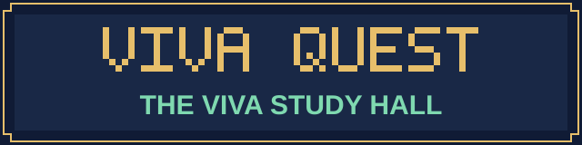

[中文](README.md) · [English](README.en.md)

<p align="center"></p>
<p align="center"></p>

# PhD Mock Viva

**An AI skill for doctoral candidates: generate thesis-grounded questions with sources, practice follow-ups, and review your answers.**

[Download the skill](dist/thesis-viva.zip?raw=true) · [Quick start](#start) · [See an example](#example) · [Report an issue](https://github.com/NoNightWatch/PhD-Mock-Viva/issues)

**VIVA QUEST** is the display name. The skill name and invocation remain **`thesis-viva` / `$thesis-viva`**. This repository provides instructions and presentation assets; you bring your own AI assistant.

<a id="modes"></a>


Generate document-specific questions with thesis evidence, examination objectives, possible follow-ups, and answer boundaries. Twelve reasoning routes are selected according to the document; the task determines the number of questions.


Read the thesis first, then ask one main question at a time. Follow the answer to examine evidence, assumptions, and reasoning. Request immediate feedback or feedback at the end of a practice segment.


Compare recalled viva questions with the thesis, distinguishing document evidence, recollections, analytical inferences, and unverified details.

**Optional: include examiner papers.** Choose once at setup and reuse the choice and materials. Prefer relevant first-author or corresponding-author papers, including explicitly designated shared roles; other coauthored work needs contribution checks. Papers may suggest scholarly interests but cannot establish the actual questions.

<a id="start"></a>


### Environment and dependencies

- Required: an AI assistant that can read Markdown instructions and the thesis body.
- PDF figures and equations also require access to the original pages. Scanned documents may need OCR. If those capabilities are unavailable, supply readable text and the necessary clear images.
- The skill has no runtime scripts, Python/Node dependencies, dedicated API key, or background service. The AI platform's own account requirements, fees, and file limits still apply.
- Network access is used when checking external sources. Local-file use requires appropriate file permissions.

### Option A: install in Codex

In a Codex environment with `$skill-installer`, send:

```text
$skill-installer
Install the thesis-viva skill from:
https://github.com/NoNightWatch/PhD-Mock-Viva/tree/main/thesis-viva
```

Alternatively, download the [skill ZIP](dist/thesis-viva.zip?raw=true) and place its `thesis-viva` folder under your project's `.agents/skills/` directory. Keep the complete folder structure and avoid overwriting an existing skill with the same name. Restart Codex if it does not appear. Refer to the [official documentation](https://learn.chatgpt.com/docs/build-skills) for installation locations and invocation details.

After installation, provide the thesis and send:

```text
$thesis-viva
Read the thesis I provided and state your reading coverage.
Confirm whether this preparation should include examiner papers,
then begin an English mock viva.
Ask one main question at a time and wait for me to finish.
```

### Option B: load manually in another AI assistant

Extract the [skill ZIP](dist/thesis-viva.zip?raw=true). Upload `SKILL.md`, both Markdown files in `references/`, and your thesis. Then send:

```text
Read SKILL.md and use the two reference files as it directs.
Begin a mock viva grounded in the thesis I supplied.
First confirm whether to include examiner papers;
then ask one question at a time.
If the thesis body or references cannot be read, identify what is missing.
```

This supplies instructions manually. File access, context capacity, and instruction-following differ between assistants. This repository has not tested compatibility with every platform and does not provide a one-click plugin package.

### Try another practice mode

```text
$thesis-viva
Use my thesis only and generate 10 questions.
For each, include chapter or figure references, questioning logic,
follow-up branches, and answer boundaries.
Save the result as Markdown.
```

```text
$thesis-viva
Review the real viva questions I provide against my thesis.
Preserve the original question numbers and distinguish document evidence,
my recollections, and analytical inferences.
```

If a readable thesis body is missing, the skill requests it first. A title or abstract alone is insufficient for document-specific questioning.

<a id="example"></a>


All examples are **fictional demonstrations**. They describe no real person, thesis, or viva record and do not represent performance-test results.

Input: [a fictional study of library seat reservations](examples/fictional-paper.md).

```text
$thesis-viva
Use examples/fictional-paper.md in thesis-only mode.
Generate 3 questions, each with sources and questioning logic.
```

Illustrative output excerpt:

> **Question:** The reservation policy and opening hours both changed between the two weeks. How could you determine how much of the change in waiting time came from the reservation policy?
>
> **Thesis evidence:** Section 2 of the fictional paper reports both changes; Section 3 gives median waiting times; Section 4 acknowledges unresolved causal attribution.
>
> **Questioning logic:** Examine the inference from an overall change to a specific factor's effect, then ask for a design that distinguishes explanations.

[Full Chinese example](examples/example-output.zh.md) · [Matching English example](examples/example-output.en.md)

<a id="workflow"></a>


1. **Provide the body:** Establish the version and reading coverage. Selected chapters support questions within their scope.
2. **Choose the mode:** Question bank, mock viva, or review. Question banks and mock vivas include a one-time setup choice about examiner papers.
3. **Map the evidence:** Locate claims, research choices, data, figures, and acknowledged limitations.
4. **Build the questions:** Examine important reasoning steps, with clear follow-up objectives and stopping conditions.
5. **Answer and reflect:** Separate evidence, plausible inference, and unknowns. An adequately supported conditional answer can end a follow-up.

Within the same preparation, requests to continue or practice another round retain the choice. A different thesis, an explicit reset, or a new conversation without recoverable records requires setup again. The skill does not promise permanent cross-conversation memory.

<a id="limits"></a>


- **Human checking remains necessary.** Pages, equations, and figures can be read incorrectly. Check important judgments against the original.
- **No pass guarantee or prediction feature.** It does not predict actual questions, examiner personality, conduct, or passing probability.
- **Feedback has an evidence boundary.** A transcript alone cannot establish pronunciation, body language, or the real viva outcome.
- **Adaptation depends on the material.** Experimental, theoretical, computational, and qualitative work use different routes; this does not establish validation in every discipline.
- **Voice depends on the host.** The skill includes no voice engine. Turn-taking in voice mode depends on the platform.
- **You manage your thesis.** The repository contains no user theses or automatic thesis-upload scripts. Files supplied to an AI assistant remain subject to that platform's data policies. Do not post confidential theses, personal information, or original viva records in public Issues.

<a id="faq"></a>


<details>
<summary>Can I begin with only an abstract?</summary>

A readable body is required. You may supply a single chapter, with practice explicitly limited to that chapter.

</details>

<details>
<summary>Are examiner papers required? Must I upload them every round?</summary>

Thesis-only preparation is available. The choice persists within the same preparation. In examiner-informed mode, received materials are reused; an inaccessible file is requested again only if it cannot be recovered.

</details>

<details>
<summary>Is every paper coauthored by an examiner suitable?</summary>

Relevance and contribution need checking. First-author or corresponding-author papers are preferred. Last authorship alone does not establish corresponding authorship, and team publications do not directly establish personal preferences.

</details>

<details>
<summary>The skill files are in English. Can I practice in Chinese?</summary>

You can request Chinese or English questions and feedback. The default follows the user's current language; expression quality depends on the model.

</details>

<details>
<summary>Will it generate reports automatically or run in the background?</summary>

Ordinary practice uses conversation. Files are created when Markdown output is requested and the environment supports writing files. The skill has no background or scheduled tasks.

</details>

<a id="feedback"></a>


Report problems through [Issues](https://github.com/NoNightWatch/PhD-Mock-Viva/issues). Include your environment, reproduction steps, and expected and actual behavior, with confidential content removed. If this helps your preparation, consider a Star or share the repository link.

The core skill and original project files use the [MIT License](LICENSE). The hero is AI-assisted artwork, and pixel panels are drawn by a repository script. No existing game characters or assets were used. See [asset provenance](assets/source/README.md) for visual and font notes.

Page organization takes inspiration from [Obsidian-Codex-CC-for-academy](https://github.com/NoNightWatch/Obsidian-Codex-CC-for-academy); the text and artwork were created for this project. Linked external documents and third-party trademarks retain their respective rights. This project is not affiliated with game publishers or AI platforms.

[Get the skill](dist/thesis-viva.zip?raw=true) · [Read the core instructions](thesis-viva/SKILL.md) · [中文](README.md)
