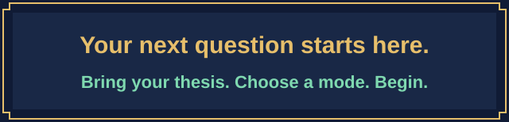

<p align="center"><a href="README.md">中文</a> · <a href="README.en.md">English</a></p>

<p align="center"></p>

<p align="center">
  <strong>You wrote the thesis. Now practice defending it.</strong><br>
  Bring your thesis for source-linked questions, adaptive follow-ups, and evidence-based review.
</p>

<p align="center">
  <a href="dist/thesis-viva.zip?raw=true"></a>
  <a href="#start"></a>
</p>

<p align="center">
  <a href="#example">See a question first</a> · <a href="#workflow">Explore the workflow</a> · <a href="#faq">Common questions</a><br>
  <sub>Thesis body and your own AI assistant required · Optional examiner papers · MIT licensed</sub>
</p>

**VIVA QUEST is a PhD viva practice guide.** Use it with an AI assistant that can read your materials to build questions from your thesis's claims, methods, and evidence. Practice explaining research choices and the limits of your conclusions through question banks, one-question-at-a-time simulations, and post-viva review.

<a id="modes"></a>


**Start where you are.** Build a question bank to find gaps, practice speaking in a mock viva, or revisit real questions after your examination.


Generate document-specific questions with thesis evidence, examination objectives, possible follow-ups, and answer boundaries. Twelve reasoning routes are selected according to the document; the task determines the number of questions.


Read the thesis first, then ask one main question at a time. Follow the answer to examine evidence, assumptions, and reasoning. Request immediate feedback or feedback at the end of a practice segment.


Compare recalled viva questions with the thesis, distinguishing document evidence, recollections, analytical inferences, and unverified details.

**Optional: bring examiner papers.** Connect questions to methods and debates in relevant research. Choose once at setup and reuse the choice and materials. Prefer relevant first-author or corresponding-author papers, including explicitly designated shared roles; other coauthored work needs contribution checks. Papers may suggest scholarly interests but cannot establish the actual questions.

<a id="start"></a>


**Your first session needs three things: the complete guide files, a readable thesis body, and an AI assistant that can read them.** Choose one setup route below. If you do not have a thesis ready, [view the fictional example first](#example).

<details>
<summary><strong>Check environment and dependencies</strong></summary>

- Required: an AI assistant that can read Markdown instructions and the thesis body.
- PDF figures and equations also require access to the original pages. Scanned documents may need OCR. If those capabilities are unavailable, supply readable text and the necessary clear images.
- The guide has no runtime scripts, Python/Node dependencies, dedicated API key, or background service. The AI platform's own account requirements, fees, and file limits still apply.
- Network access is used when checking external sources. Local-file use requires appropriate file permissions.

</details>

### Option A: have your assistant read the local guide

Download the [complete viva guide](dist/thesis-viva.zip?raw=true), extract it, and place the `thesis-viva` folder in a workspace accessible to Codex, Claude Code, or another file-reading assistant. Keep the whole folder and both references. No extension installation or configuration change is needed to begin.

Provide the thesis body and send your first-session prompt:

```text
Read the workflow guide and relevant references in the thesis-viva folder.
Read the thesis I provided and state your reading coverage.
Confirm whether this preparation should include examiner papers,
then begin an English mock viva.
Ask one main question at a time and wait for me to finish.
```

### Option B: provide the materials to a chat assistant

1. Download and extract the [guide ZIP](dist/thesis-viva.zip?raw=true), keeping the complete `thesis-viva` folder.
2. Give your assistant the [workflow guide](thesis-viva/SKILL.md), both Markdown files in `references/`, and the thesis body.
3. Copy this prompt to begin:

```text
Read the VIVA QUEST workflow guide I provided and use its two references as directed.
Begin a mock viva grounded in the thesis I supplied.
First confirm whether to include examiner papers;
then ask one question at a time.
If the thesis body or references cannot be read, identify what is missing.
```

This supplies instructions manually. File access, context capacity, and instruction-following differ between assistants. This repository has not tested compatibility with every platform and does not provide a one-click plugin package.

### Try another practice mode

```text
Continue using the VIVA QUEST guide you have read.
Use my thesis only and generate 10 questions.
For each, include chapter or figure references, questioning logic,
follow-up branches, and answer boundaries.
Save the result as Markdown.
```

```text
Continue using the VIVA QUEST guide you have read.
Review the real viva questions I provide against my thesis.
Preserve the original question numbers and distinguish document evidence,
my recollections, and analytical inferences.
```

**What happens next?** The assistant states its reading coverage, confirms whether to include examiner papers, and then asks the first question. Explicitly choose thesis-only mode to skip examiner materials. If a readable body is missing, it requests that first; a title or abstract alone is insufficient for document-specific questioning.

<a id="example"></a>


All examples are **fictional demonstrations**. They describe no real person, thesis, or viva record and do not represent performance-test results.

Input: [a fictional study of library seat reservations](examples/fictional-paper.md).

```text
Continue using the VIVA QUEST guide you have read.
Use examples/fictional-paper.md in thesis-only mode.
Generate 3 questions, each with sources and questioning logic.
```

Illustrative output excerpt:

> **Question:** The reservation policy and opening hours both changed between the two weeks. How could you determine how much of the change in waiting time came from the reservation policy?
>
> **Thesis evidence:** Section 2 of the fictional paper reports both changes; Section 3 gives median waiting times; Section 4 acknowledges unresolved causal attribution.
>
> **Questioning logic:** Examine the inference from an overall change to a specific factor's effect, then ask for a design that distinguishes explanations.

[Full Chinese example](examples/example-output.zh.md) · [Matching English example](examples/example-output.en.md)

Every question should answer two checks: **Where does it come from in the thesis? Why is it worth asking?** Your practice questions are built afresh from the body you provide.

<a id="workflow"></a>


1. **Provide the body:** Establish the version and reading coverage. Selected chapters support questions within their scope.
2. **Choose the mode:** Question bank, mock viva, or review. Question banks and mock vivas include a one-time setup choice about examiner papers.
3. **Map the evidence:** Locate claims, research choices, data, figures, and acknowledged limitations.
4. **Build the questions:** Examine important reasoning steps, with clear follow-up objectives and stopping conditions.
5. **Answer and reflect:** Separate evidence, plausible inference, and unknowns. An adequately supported conditional answer can end a follow-up.

Within the same preparation, requests to continue or practice another round retain the choice. A different thesis, an explicit reset, or a new conversation without recoverable records requires setup again. The guide does not promise permanent cross-conversation memory.

<a id="limits"></a>


- **Human checking remains necessary.** Pages, equations, and figures can be read incorrectly. Check important judgments against the original.
- **No pass guarantee or prediction feature.** It does not predict actual questions, examiner personality, conduct, or passing probability.
- **Feedback has an evidence boundary.** A transcript alone cannot establish pronunciation, body language, or the real viva outcome.
- **Adaptation depends on the material.** Experimental, theoretical, computational, and qualitative work use different routes; this does not establish validation in every discipline.
- **Voice depends on the host.** The guide includes no voice engine. Turn-taking in voice mode depends on the platform.
- **You manage your thesis.** The repository contains no user theses or automatic thesis-upload scripts. Files supplied to an AI assistant remain subject to that platform's data policies. Do not post confidential theses, personal information, or original viva records in public Issues.

<a id="faq"></a>


<details>
<summary>Can I begin with only an abstract?</summary>

A readable body is required. You may supply a single chapter, with practice explicitly limited to that chapter.

</details>

<details>
<summary>Are examiner papers required? Must I upload them every round?</summary>

Thesis-only preparation is available. The choice persists within the same preparation. In examiner-informed mode, received materials are reused; an inaccessible file is requested again only if it cannot be recovered.

</details>

<details>
<summary>Is every paper coauthored by an examiner suitable?</summary>

Relevance and contribution need checking. First-author or corresponding-author papers are preferred. Last authorship alone does not establish corresponding authorship, and team publications do not directly establish personal preferences.

</details>

<details>
<summary>The guide files are in English. Can I practice in Chinese?</summary>

You can request Chinese or English questions and feedback. The default follows the user's current language; expression quality depends on the model.

</details>

<details>
<summary>Will it generate reports automatically or run in the background?</summary>

Ordinary practice uses conversation. Files are created when Markdown output is requested and the environment supports writing files. The guide has no background or scheduled tasks.

</details>

<a id="feedback"></a>


<p align="center"><a href="#start"></a></p>

Ready to begin? [Get the guide](dist/thesis-viva.zip?raw=true), bring your thesis, and choose a practice mode. If it helps your preparation, consider a **Star** or share it with someone preparing for their viva.

Report problems through [Issues](https://github.com/NoNightWatch/EZ-PhD-Mock-Viva/issues). Include your environment, reproduction steps, and expected and actual behavior. Remove confidential thesis content before posting.

The guide and original project files use the [MIT License](LICENSE).

<p align="center"><a href="dist/thesis-viva.zip?raw=true">Get the guide</a> · <a href="thesis-viva/SKILL.md">Read the core instructions</a> · <a href="#start">Back to the start</a> · <a href="README.md">中文</a></p>
