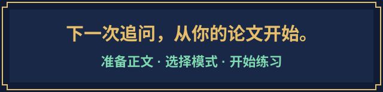

<p align="center"><a href="README.md">中文</a> · <a href="README.en.md">English</a></p>

<p align="center"></p>

<p align="center">
  <strong>论文写完了，下一步是把它讲清楚。</strong><br>
  带上你的论文，练习有出处的提问、随回答展开的追问，以及有依据的复盘。
</p>

<p align="center">
  <a href="dist/thesis-viva.zip?raw=true"></a>
  <a href="#start"></a>
</p>

<p align="center">
  <a href="#example">先看一次提问</a> · <a href="#workflow">了解练习流程</a> · <a href="#faq">常见问题</a><br>
  <sub>需要论文正文与自己的 AI 助手 · 可选考官论文 · MIT 开源</sub>
</p>

**VIVA QUEST 是面向博士生的 AI 模拟答辩 skill。** 它让助手从论文的主张、方法和证据中组织问题，帮助你练习解释研究选择与结论边界。技能名称与调用标识保持 **`thesis-viva` / `$thesis-viva`**。

<a id="modes"></a>


**从你当前的准备阶段开始。** 想找遗漏，先列问题；想练表达，进行模拟；已经答辩，回看真实问题。


生成针对论文的问题清单。每题包含论文依据、考察目标、可能的追问和回答边界。十二类提问逻辑按论文选择，题数由任务决定。


先读取论文，再一次问一道主问题。根据回答检验证据、假设与推理；可要求即时反馈或阶段结束后反馈。


把你回忆的答辩问题与论文对照，区分原文事实、现场回忆、分析推断及待核实内容。

**可选：带上考官论文。** 让提问结合相关研究中的方法与争论。启动时选择一次，后续复用选择与材料。优先相关的第一作者或通讯作者论文，包括明确标注的共同角色；其他合著论文需核对具体贡献。材料用于推测学术关注点，不能确定真实考题。

<a id="start"></a>


**第一轮需要三样东西：完整 skill 文件、可读论文正文、能够读取它们的 AI 助手。** 按你的使用环境选择下面一种方式。暂时没有自己的论文，也可以[先看虚构示例](#example)。

<details>
<summary><strong>展开环境与依赖</strong></summary>

- 必需：能够读取 Markdown 指令及论文正文的 AI 助手。
- 涉及 PDF 图表或公式时，助手还需能查看原页；扫描件可能需要 OCR。缺少这些能力时，提供可读正文和必要的清晰图像。
- Skill 本身没有运行脚本、Python/Node 依赖、专用 API 密钥或后台服务。AI 平台自身的账号、费用和文件限制仍适用。
- 联网仅在核验外部资料时使用；本地文件模式需要相应文件访问权限。

</details>

### 方式 A：在 Codex 中安装

在提供 `$skill-installer` 的 Codex 环境中，复制这段安装指令：

```text
$skill-installer
Install the thesis-viva skill from:
https://github.com/NoNightWatch/PhD-Mock-Viva/tree/main/thesis-viva
```

也可下载 [skill ZIP](dist/thesis-viva.zip?raw=true)，将其中的 `thesis-viva` 文件夹放到你项目的 `.agents/skills/` 下。保留整个文件夹结构，避免覆盖已有同名技能。若安装后未显示，重启 Codex。安装路径和调用方式以[官方文档](https://learn.chatgpt.com/docs/build-skills)为准。

安装完成后提供论文正文，再发送第一轮练习指令：

```text
$thesis-viva
请先读取我提供的论文正文，并说明已阅读的范围。
确认本次是否加入考官论文，然后开始英文模拟答辩。
一次只问一道主问题，等我说完再继续。
```

### 方式 B：在其他 AI 助手中手动加载

1. 下载并解开 [skill ZIP](dist/thesis-viva.zip?raw=true)，保留整个 `thesis-viva` 文件夹。
2. 向助手提供 `SKILL.md`、`references/` 中的两个 Markdown 文件，以及你的论文正文。
3. 复制下面的指令，开始第一轮：

```text
请读取 SKILL.md，并按其中的路由使用两份 reference 文件。
以我提供的论文为依据，开始模拟答辩。
先确认是否加入考官论文；之后一次问一个问题。
如果正文或引用文件无法读取，请先说明缺少什么。
```

这是手动提供指令的方式。不同助手的文件读取、上下文容量和指令遵循能力不同；本仓库没有完成所有平台的兼容性测试，也不提供一键插件安装包。

### 换一种练习方式

```text
$thesis-viva
仅基于我的论文，生成 10 个问题。
每题列出章节或图表出处、提问逻辑、追问分支和回答边界。
请保存为 Markdown。
```

```text
$thesis-viva
对照我的论文，复盘我提供的真实答辩问题。
保留原题号，区分原文依据、我的回忆与分析推断。
```

**启动后会发生什么？** 助手先确认论文读取范围，再确认是否加入考官论文，随后提出第一道问题。明确选择“仅基于论文”即可跳过考官材料。未提供可读正文时，会先索取正文；题目或摘要不足以启动针对论文的提问。

<a id="example"></a>


所有示例均为**虚构演示**，与真实个人、论文或答辩记录无关，也不代表性能测试结果。

输入：[一篇虚构的图书馆座位预约研究](examples/fictional-paper.md)。

```text
$thesis-viva
使用 examples/fictional-paper.md，选择仅基于论文的模式。
生成 3 个问题，每题说明出处和提问逻辑。
```

示例输出节选：

> **问题：** 两周之间同时改变了预约规则和开放时长。你如何判断等待时间的变化中，有多少可以归于预约规则？
>
> **论文依据：** 虚构论文第 2 节报告两个同时发生的变化；第 3 节给出等待时间中位数；第 4 节承认因果归属尚未分开。
>
> **提问逻辑：** 检验整体变化与单项因素效应之间的推理，接着询问能区分解释的比较设计。

[完整中文示例](examples/example-output.zh.md) · [对应英文示例](examples/example-output.en.md)

每个问题都应能回答两个追问：**它来自论文哪里？为什么值得问？** 正式练习会依据你提供的正文重新构建问题。

<a id="workflow"></a>


1. **提供正文**：确认版本与阅读范围。部分章节只能支持对应范围的问题。
2. **选择模式**：问题清单、模拟答辩或复盘。问题清单和模拟答辩在启动时确认一次是否加入考官论文。
3. **建立依据**：定位主张、研究选择、数据、图表与已声明的局限。
4. **形成问题**：针对关键推理提出问题，明确追问目标和结束条件。
5. **回答与反馈**：区分已有证据、合理推测和未知部分；有依据的限定回答可以结束该追问。

同一次准备中说“继续”或“再练一轮”，会沿用选择。换论文、明确重置，或在无法恢复记录的新会话中开始时，需要重新设置。Skill 不承诺跨会话永久记忆。

<a id="limits"></a>


- **需要人工复核。** 页码、公式和图表可能读取有误，重要判断应回到原文。
- **没有保过或预测功能。** 不预测真实考题、考官性格、现场行为或通过概率。
- **反馈有证据范围。** 仅凭文字转录不能评价发音、肢体表现或真实答辩结果。
- **适配取决于材料。** 实验、理论、计算和定性研究采用不同提问路径；不能据此声称在所有学科均已验证。
- **语音由宿主提供。** Skill 没有语音引擎；语音模式的接话时机受平台影响。
- **论文由你管理。** 仓库不包含用户论文，也没有自动上传论文的脚本。你向 AI 提供的文件仍受该平台的数据政策约束。不要把保密论文、个人信息或原始答辩记录提交到公开 Issues。

<a id="faq"></a>


<details>
<summary>只有摘要，可以开始吗？</summary>

需要可读正文。可以只提供某个章节，但练习范围会明确限定到该章节。

</details>

<details>
<summary>必须提供考官论文吗？每轮都要上传吗？</summary>

可选择仅基于论文。选择在同一次准备中保留。启用考官论文模式后，已读取的材料会复用；文件失效且无法恢复时才需要补充。

</details>

<details>
<summary>考官参与过的所有论文都适合吗？</summary>

需要筛选相关性和作者贡献。优先第一作者或通讯作者论文。末位作者身份本身不能证明通讯作者身份；团队论文也不能直接等同个人偏好。

</details>

<details>
<summary>Skill 文件是英文，能用中文练习吗？</summary>

可以要求中文或英文提问与反馈。默认跟随当前用户语言，实际表达质量取决于使用的模型。

</details>

<details>
<summary>会自动生成报告或在后台运行吗？</summary>

普通练习使用对话。要求保存 Markdown 且环境支持文件写入时，才生成文件。Skill 没有后台任务或定时功能。

</details>

<a id="feedback"></a>


<p align="center"><a href="#start"></a></p>

准备开始了？[下载 skill](dist/thesis-viva.zip?raw=true)，带上论文，选一种练习方式。如果对你的准备有帮助，欢迎 **Star**，或把仓库分享给正在准备答辩的同学。

使用中遇到问题，请通过 [Issues](https://github.com/NoNightWatch/PhD-Mock-Viva/issues) 提供环境、复现步骤、预期和实际行为。提交前删去论文私密内容。

核心技能与本项目原创文件采用 [MIT License](LICENSE)。横幅由 AI 辅助生成，像素面板由本仓库脚本绘制；未使用现成游戏角色或素材。视觉与字体说明见 [素材来源](assets/source/README.md)。

页面组织参考 [Obsidian-Codex-CC-for-academy](https://github.com/NoNightWatch/Obsidian-Codex-CC-for-academy)，文字和画面为本项目重新制作。引用的外部文档及第三方商标保留各自权利。本项目与游戏发行方及 AI 平台无官方关联。

<p align="center"><a href="dist/thesis-viva.zip?raw=true">下载 skill</a> · <a href="thesis-viva/SKILL.md">阅读核心指令</a> · <a href="#start">回到开始</a> · <a href="README.en.md">English</a></p>
